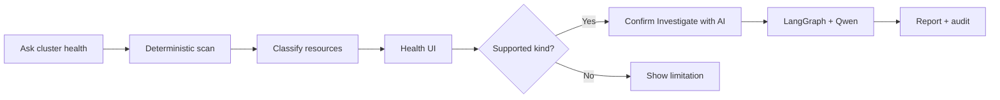

# Kubernetes diagnostic demo (read-only)

## Prerequisites

1. Kind (or other) cluster with namespace `ai-ops-demo`.
2. Apply investigator RBAC (namespaced only):

```bash
kubectl apply -f k8s/lab/private-ai-investigator-rbac.yaml
```

3. Do **not** apply the optional ClusterRole for nodes/PVs unless a human
   explicitly approves cluster-scoped reads.
4. Sign in to the Private AI SRE console with a principal allowed for `ai-ops-demo`.

## End-to-end: health → investigate

1. Open **Health** (`/cluster-health`).
2. Leave scope as **All authorized** or pick `ai-ops-demo`, then **Refresh**.
3. Confirm the summary shows Unhealthy / Degraded / Unknown / Healthy counts and
   that Node coverage is `permission_denied` (expected without ClusterRole).
4. Filter to **Unhealthy** if needed.
5. Pick a supported row (Deployment, StatefulSet, DaemonSet, or Pod).
6. Click **Investigate with AI** → **Confirm**.
7. On New investigation, verify namespace / kind / name are exact, then click
   **Investigate**.
8. On the report: verified findings cite evidence IDs; AI hypotheses stay
   unverified; audit trail lists read-only tools only.

Unsupported kinds (Service, Job, CronJob, PVC, HPA, PDB, ReplicaSet, Node)
show **Not supported yet** instead of a misleading button.

## Lab fixtures (operator consent required)

Existing scenarios under `k8s/lab/`:

| File | Exercises |
|---|---|
| `eval-workload-kinds.yaml` | Failing **Deployment**, **StatefulSet**, and **DaemonSet** (liveness, OOM, crash, image pull, readiness, multi-container) |
| `eval-pod-level.yaml` | Scheduling / mount / liveness eval Deployments |
| `scenario-crashloop.yaml` | CrashLoopBackOff |
| `scenario-oom.yaml` | OOMKilled |
| `scenario-imagepullbackoff.yaml` | ImagePullBackOff |
| `scenario-livenessprobefailure.yaml` | Liveness probes |
| `scenario-readinessprobefailure.yaml` | Readiness probes |
| `scenario-scheduling.yaml` | FailedScheduling |
| `scenario-service-select-mismatch.yaml` | Service selector mismatch |
| `scenario-configmap.yaml` | Volume / config references |

```bash
kubectl apply -f k8s/lab/eval-workload-kinds.yaml
kubectl apply -f k8s/lab/scenario-service-select-mismatch.yaml
kubectl apply -f k8s/lab/scenario-scheduling.yaml

# Cleanup workload-kind fixtures
kubectl delete deploy,sts,ds,svc -n ai-ops-demo -l eval=workload-kinds
```

## Live checks

```bash
# Role pin
.venv/bin/python -m pytest tests/test_investigator_rbac_manifest.py -q

# Live investigator permissions
KUBECONFIG=~/.kube/private-ai-investigator.kubeconfig \
  .venv/bin/python scripts/verify_investigator_rbac.py --namespace ai-ops-demo

# Live cluster-health scan (no language model)
KUBECONFIG=~/.kube/private-ai-investigator.kubeconfig \
  .venv/bin/python - <<'PY'
from app.health.cluster_reader import ClusterHealthReader
from app.health.cluster_scan import run_cluster_health
from app.security.api_keys import APIKeyPrincipal
r = run_cluster_health(
    principal=APIKeyPrincipal("demo", frozenset({"ai-ops-demo"})),
    reader=ClusterHealthReader(),
    namespace="ai-ops-demo",
)
print(r.category, r.counts.model_dump(), "model=", r.language_model_used)
print("affected", len(r.resources), "complete", r.assessment_complete)
PY
```

## What to show on demo

1. **Cluster health** without calling Qwen.
2. **Partial coverage** disclosed (nodes not inspected).
3. **Investigate with AI** only for supported kinds, with confirmation.
4. **Verified finding** for ImagePull / OOM / CrashLoop / unschedulable /
   Service selector mismatch — evidence IDs cited; cause hedged.
5. **Unverified** Qwen hypothesis remains labeled unverified.
6. **PDB/HPA** findings (when objects exist) are not classified as container
   CrashLoop.

## Workflow



## Rollback

```bash
git checkout feature/v0.9-investigation-reports -- \
  k8s/lab/private-ai-investigator-rbac.yaml \
  app/tools/handlers.py app/tools/registry.py app/reports/grounding.py
```
